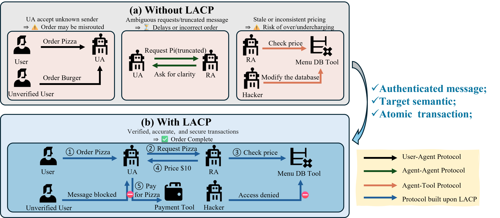

<div align="center">

# LACP

### LLM Agent Communication Protocol (LACP) Requires Urgent Standardization: A Telecom-Inspired Protocol is Necessary

[Xin Li](https://lixin.ai/), [Mengbing Liu](https://liumengbing.com/), [Chau Yuen](https://blogs.ntu.edu.sg/chau-yuen/)<br>
Nanyang Technological University

[](https://ai4nextg.github.io/)
[](https://openreview.net/forum?id=LpwE9cSLkS)
[](assets/NeurIPS_LACP_workshop.pdf)
[](https://lixin.ai/LACP/)
[](#license)

**A Telecom-Inspired Protocol for AI Agent Interoperability in Next Generation Networks**

</div>

<p align="center">
  
</p>

## The idea in 30 seconds

- **Position paper.** This work argues that the field of LLM agents requires urgent standardization through a unified,
  telecom-inspired communication protocol to ensure safety, interoperability, and scalability in NextG networks.
- **The problem.** Current ad-hoc communication methods in LLM agents are creating a fragmented ecosystem, reminiscent
  of the early "protocol wars" in networking.
- **LACP.** The LLM-Agent Communication Protocol is a three-layer architecture inspired by telecommunications standards
  that ensures semantic clarity, transactional integrity, and built-in security for multi-agent systems.
- **Key contributions.**
  1. **Risk Analysis**: Identification of systemic risks from fragmented agent communication
  2. **Design Principles**: Guidelines for robust, interoperable protocols from telecom history
  3. **Protocol Proposal**: LACP - a layered, secure, and extensible framework

## Architecture

LACP implements a **three-layer architecture** with mutually-insulated layers:

### 1. Semantic Layer
- **Purpose**: Conveys the *intent* of communication
- **Message Types**:
  - `PLAN` - Express high-level intent
  - `ACT` - Invoke external tools
  - `OBSERVE` - Return results/status

### 2. Transactional Layer
- **Purpose**: Ensures reliability and integrity
- **Features**:
  - Message signing with JSON Web Signatures (JWS)
  - Message sequencing for ordered delivery
  - Unique transaction IDs for idempotency
  - Two-phase commit for atomic operations

### 3. Transport Layer
- **Purpose**: Handles efficient and secure delivery
- **Protocols**: HTTP/2, QUIC, WebSockets
- **Features**: Binary encoding, transport-agnostic design

## Main results

**Performance metrics.**
- **3.5%** Latency overhead for complex messages
- **30%** Size overhead for realistic payloads
- **3** Layer modular architecture
- **10,000+** Messages tested across payload sizes

**Performance analysis.**
- Minimal latency impact on realistic agent interactions
- Overhead inversely proportional to message complexity
- Comprehensive testing across various payload sizes

**Interoperability demo.**
- Successful LangChain ↔ Framework-agnostic tool communication
- Seamless integration without custom code
- Universal message format compatibility

**Security validation.**
- ✅ Tampering attacks blocked by signature verification
- ✅ Replay attacks prevented by transaction ID tracking
- ✅ Application-layer security beyond TLS

## Current protocol landscape

| Protocol | Transport | Authentication |
|----------|-----------|---------------|
| OpenAI Function Calling | JSON schema | API key only |
| LangChain Agent Protocol | REST API | HTTP/JWT only |
| Anthropic MCP | JSON-RPC/HTTP | OAuth 2.1 |
| IBM/LF ACP | JSON-RPC | Signed capability tokens |
| Google A2A | HTTP/Protobuf | Capability discovery |

## Telecommunications insights

LACP draws from successful telecom standardization principles:

- **Consensus-Driven Standards**: Open collaboration prevents vendor lock-in
- **Security by Construction**: Security fundamental at every layer
- **Layered Abstractions**: Independent component evolution
- **Narrow Waist Design**: Stable core with extensible edges

## Repository layout

This repository holds the project page and the paper:

```
LACP/
├── index.html          # Main project website
├── css/
│   └── style.css       # Styling and responsive design
├── js/
│   └── script.js       # Interactive functionality
├── images/             # Architecture diagrams and figures
├── assets/             # PDF papers and documentation
└── README.md           # This file
```

## Citation

```bibtex
@inproceedings{li2025lacp,
    title={{LLM} Agent Communication Protocol ({LACP}) Requires Urgent Standardization: A Telecom-Inspired Protocol is Necessary},
    author={Xin Li and Mengbing Liu and Chau Yuen},
    booktitle={NeurIPS 2025 Workshop: AI and ML for Next-Generation Wireless Communications and Networking},
    year={2025},
    url={https://openreview.net/forum?id=LpwE9cSLkS}
}
```

## License

This project is licensed under the MIT License.

## Contributing

We welcome contributions! Please feel free to submit issues, feature requests, or pull requests.

## Contact

For questions or collaborations, please contact:
- Xin Li: xin019@e.ntu.edu.sg

---

<div align="center">
<strong>🚀 LACP: Building the Future of AI Agent Communication</strong><br>
<em>Standardization through Telecommunications Wisdom</em>
</div>
